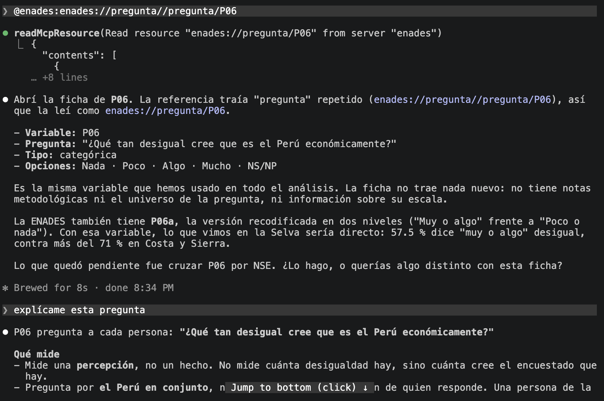
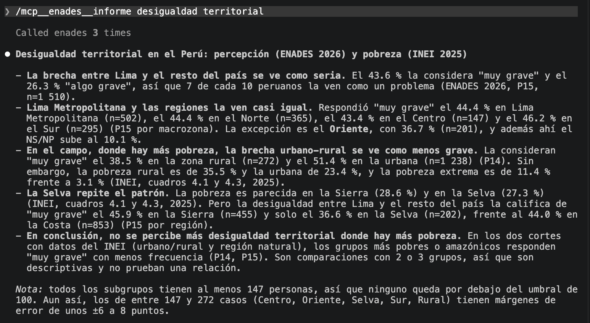
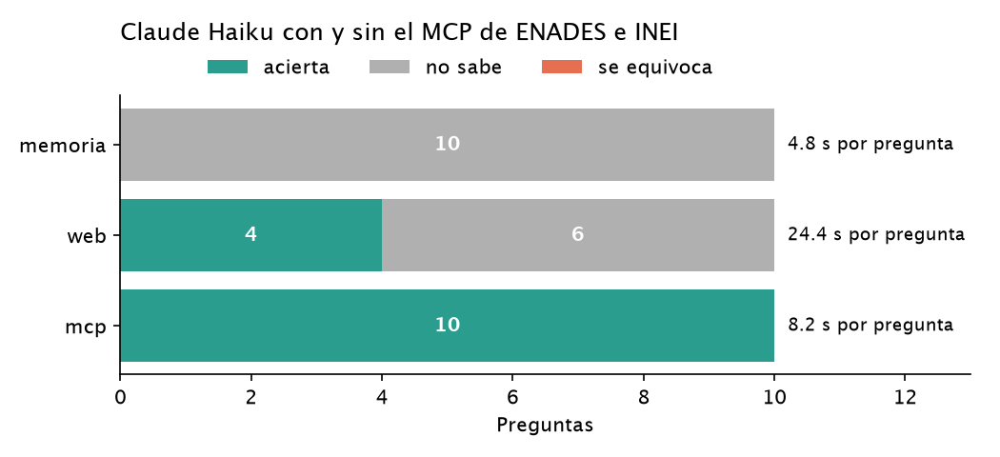

# Informe · ¿Le sirve a Claude un MCP de la ENADES 2026 y el INEI?

<!-- Reemplacen todo lo que está entre [corchetes] y borren estos comentarios antes de entregar. -->

## 1. Qué construí

Elegí dos fuentes para este proyecto. La primera es la ENADES, producida por el IEP y Oxfam. Esta mide la percepción de desigualdad en el Perú. La segunda es los niveles de pobreza de INEI. 

| Herramienta | Para qué sirve |
|---|---|
| `buscar_preguntas` | [ ] |
| `distribucion` | [ ] |
| `resumen` | [ ] |
| `pobreza` | [ ] |
| `percepcion_vs_pobreza` (propia) | [ ] |

Recurso: `enades://pregunta/{variable}` · Prompt: `/mcp__enades__informe`.

**El recurso con @ en Claude Code:**

**El prompt con / en Claude Code:**

## 2. Cómo lo medí

- 10 preguntas en `preguntas.csv`: 4 de la ENADES, 4 del INEI y 2 mías sobre P09 (autopercepción de clase).
- La verdad de cada pregunta sale de los informes publicados, no del MCP.
- `evaluar.py` con Claude Haiku, en tres modos: `memoria` (sin herramientas), `web` (WebSearch y WebFetch) y `mcp`.
- `resultados_base.csv`: corrida memoria vs. mcp. `resultados.csv`: experimento extra con los tres modos.

## 3. Resultados

| Modo | Acierta | No sabe | Se equivoca | Segundos por pregunta |
|---|---|---|---|---|
| memoria | 0 | 10 | 0 | 4.8 |
| web | 4 | 6 | 0 | 24.4 |
| mcp | 10 | 0 | 0 | 8.2 |

## 4. Qué acertó y qué no, y por qué

**Memoria.** Es posible que Claude haya rellenado con null porque el modelo es anterior a la publicación de estos reportes. Por ello, no acierta ninguna.

**Web.** Solo acertó 4 y para otras 6 coloca null.  

**MCP.** Acierta las 10

## 5. Lo que encontré sobre desigualdad

No se evidencia una relación entre los niveles de pobreza y la percepción de desigualdad por regiones. Algunas regiones tienen una población encuestada para la ENADES muy pequeña. 

## 6. Dos cifras comprobadas a mano

| Cifra | Dónde la comprobé | Valor publicado | Valor del MCP |
|---|---|---|---|
| P09 «Baja», Perú rural | [Informe IEP ENADES 2026, p. 118](https://estudiosdeopinion.iep.org.pe/wp-content/uploads/2026/12/Oxfam-IEP.-ENADES-2026.-Informe.pdf) | 37 % | 37.3 % |
| Pobreza monetaria rural 2025 | [INEI, cuadro 4.1, p. 72](https://cdn.www.gob.pe/uploads/document/file/9911234/8087825-informe-tecnico-de-pobreza-monetaria-2016-2025.pdf) | 35 % | 35.5 % |

## 7. Limitaciones

- La ENADES tiene 1,510 entrevistas: los cruces por grupos pequeños (p. ej. rural, n = 272) son menos precisos.
- La comparación con el INEI solo es posible por área y región natural.

## 8. Conclusión

Claude fue útil para contrastar información de INEI y la ENADES. Es interesante ver esta forma en que la IA no alucina datos cuando el MPC puede limitar sus fuentes. 
